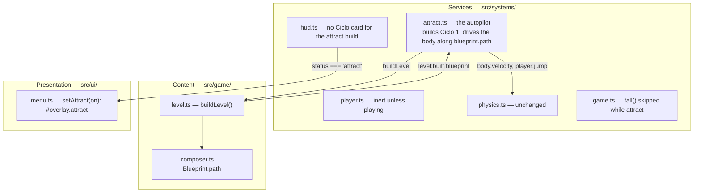

# Plan next — Attract mode

Design for [spec.md](spec.md).

## 1. Module map

One new system in the services layer, one new value in the run state machine, and a
handful of one-line guards in systems that must stay inert while the autopilot runs.

| Module | Change | Covers |
| :--- | :--- | :--- |
| `src/systems/attract.ts` | New. On init from `menu`: `buildLevel(world, 1)`, then `status = 'attract'`. Each step: steer the body toward the next `blueprint.path` node, jump when the ground probe ahead finds nothing or the node is higher, restart at the origin at the end of the route or on `body:fell`. Holds still under reduced motion or while the document is hidden. Ends on `game:start`. | REQ-AM.01, .02, .04, .05, .06 |
| `src/main.ts` | Register the system after `player` and before the enemy systems. | REQ-AM.01 |
| `src/systems/game.ts` | `body:fell` for the player is ignored while `status === 'attract'` (the autopilot restarts the run itself). | REQ-AM.02, .03 |
| `src/systems/hud.ts` | The binder pushes `status === 'attract'` to the menu. The Ciclo card never shows for the attract build because the HUD is registered after the autopilot in `src/main.ts` and so never receives its `level:built`. | REQ-AM.07 |
| `src/ui/menu.ts`, `src/style.css` | `setAttract(on)` toggles `#overlay.attract`, a lighter backdrop that keeps the panel's own glass. | REQ-AM.07 |
| `docs/21-data-model.md` | `status` gains `'attract'`. | — |

## 2. Key decisions

1. **A new status, `attract`, rather than a flag on `playing`.** Every system that must
   stay inert (`player`, `enemy`, `interceptor`, `drone`, `projectile`, `triggers`,
   `powerups`, `audio`, `damage()`) already gates on `status === 'playing'`. A new value
   inherits all of those guards for free; a flag would have needed a guard in each.
   Discarded: driving the real `Input` with virtual keys and widening the `player` gate to
   `attract`, which would also have let a visitor's keyboard steer the autopilot.
2. **The autopilot writes `body.velocity` directly and follows `blueprint.path`.** The
   path is the composer's own critical route, verified reachable by `tests/level.test.ts`,
   so the autopilot needs no search. Physics, grounding, bounce pads and crumbling
   platforms behave as in play because the body is an ordinary body. Discarded: a scripted
   camera flythrough with no avatar (does not read as gameplay) and a recorded human run
   (a recording goes stale with every tuning change).
3. **Reduced motion means a still track, not no track.** The scene is still the best
   first screen the game has; only the autonomous motion is withheld. CSS already
   neutralises the panel animations under the same media query.
4. **Visibility is handled in the system, not only by `requestAnimationFrame`.** A hidden
   tab stops the frame loop, but the accumulator catches up to `maxFrame` on return; the
   explicit hold keeps the resume clean and makes the behaviour testable.
5. **No ADR.** No dependency, no public contract and no architectural boundary changes;
   the new status value is recorded in the data model.

## 3. Data model additions

- `world.state.status`: `'attract'` added to the union.
- `world.state.attract`: `true` while the Ciclo on screen was built by the autopilot
  (set before `buildLevel`, cleared on `game:start`). The autopilot accepts only the
  `level:built` that carries it, because the event fires before the status is switched.

## 4. Test strategy

`tests/attract.test.ts`, unit, jsdom, with the real `buildLevel`, `physicsSystem` and
`gameSystem`:

| Requirement | Test |
| :--- | :--- |
| REQ-AM.01 | builds Ciclo 1 from the menu and switches to `attract` |
| REQ-AM.02 | moves Lúmen along the route; restarts at the origin when it falls |
| REQ-AM.03 | leaves `collected`, `score`, `combo` and `integrity` untouched |
| REQ-AM.04 | holds still under reduced motion |
| REQ-AM.05 | holds while hidden and resumes when visible |
| REQ-AM.06 | hands over to `game:start` untouched |
| REQ-AM.07 | manual: browser captures at 1280 px and 375 px |

## 5. Risks

- **The autopilot misses a jump on a chunk this plan did not watch.** Ciclo 1 draws from
  `anchor_bridge`, `rest_beacon`, `spiral_ascent` and `bounce_towers`; the fall path
  restarts the run, so the worst case is a visible loop, not a stuck screen.
- **The lighter overlay hurts legibility on a bright scene.** The panel keeps its own
  16 px glass blur and background, so only the area around it changes.
